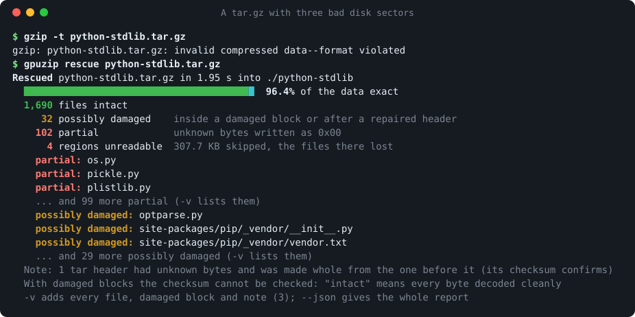
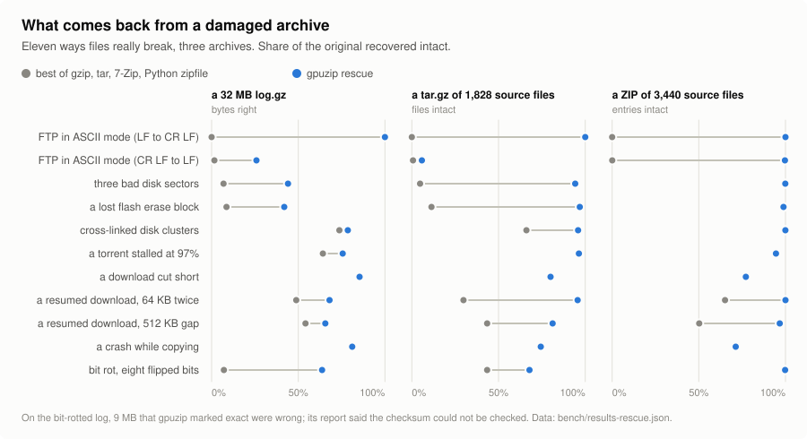
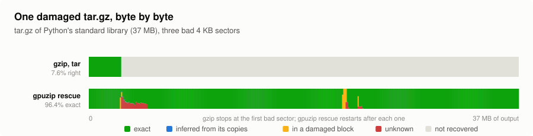
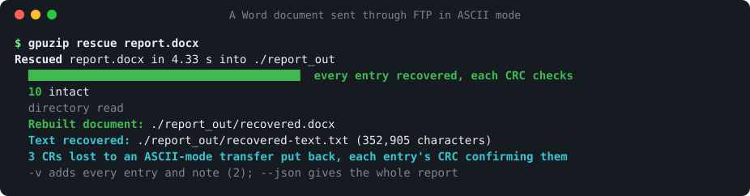
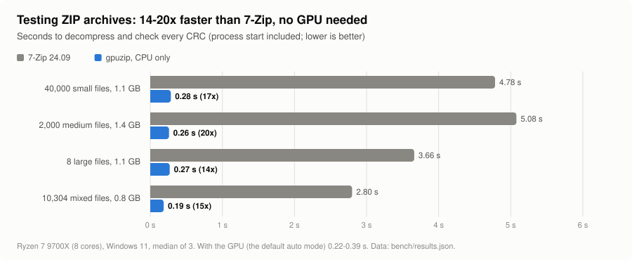
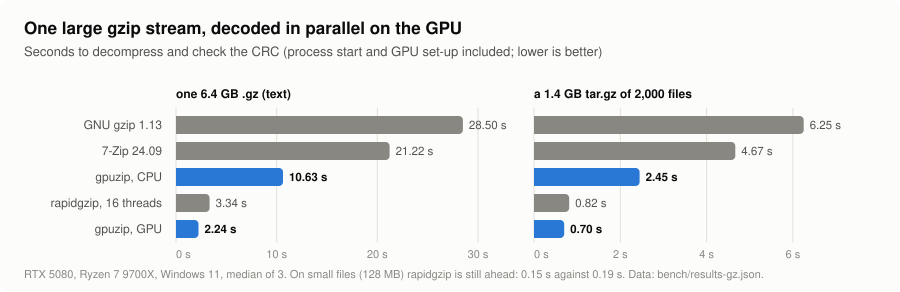

# gpuzip

**Get back what a damaged archive still holds, and extract healthy ones fast: on any CPU, and
faster still on an NVIDIA GPU.**

[](https://github.com/andresayac/gpuzip/actions/workflows/ci.yml)
[](https://github.com/andresayac/gpuzip/releases)


gzip, tar and 7-Zip stop at the first damaged byte. `gpuzip rescue` keeps going: it decodes a
broken `.gz`, `.tar.gz`, `.zip` or Office document block by block, gives back every file that
survived, and says exactly which bytes are certain and which are not.



- **Rescue** damaged `.gz`, `.tar.gz`, `.zip`, `.docx`, `.xlsx` and `.pptx` files: bad disk
  sectors, interrupted or wrongly resumed downloads, FTP transfers in ASCII mode, bit rot. Every
  file comes out marked intact, inferred, possibly damaged or partial, and the report says what
  could not be checked. Office documents are rebuilt so that Word, Excel and PowerPoint open them.
- **Extract and test** ZIP, `.gz` and `.tar.gz` on every CPU core: a ZIP tests 14-20x faster
  than with 7-Zip and extracts 1.5-8x faster (creating the files is most of that time), every CRC
  checked, paths that would escape the output folder refused. RAR, 7z and the rest go to 7-Zip.
- **On an NVIDIA GPU**, one large `.gz` is decoded in parallel by thousands of GPU threads with
  [gpuinflate](gpuinflate), a decoder of our own: 6.4 GB in 2.2 s, 9.5x 7-Zip and 1.5x
  rapidgzip on 16 threads. The GPU is optional; without one everything runs on the CPU.

## Rescue

Eleven ways files really break, each applied to a log, a tar.gz and a ZIP, then opened with the
usual tools and with `gpuzip rescue`:

<picture>
  <source media="(prefers-color-scheme: dark)" srcset="docs/img/rescue-dark.svg">
  
</picture>

| Damaged file | gzip, tar, 7-Zip, zipfile (best) | gpuzip rescue |
|---|---|---|
| tar.gz of Python's library, three bad sectors | 87 of 1,828 files | **1,722** |
| the same, a download resumed with 64 KB twice | 544 files | **1,748** |
| the same, sent through FTP in ASCII mode | 0 files | **all 1,828** |
| ZIP of 3,440 files, resumed past a 512 KB gap | 1,729 entries | **3,326** |
| the same, every CR LF turned into LF | 3 entries | **3,429** (233 CRs put back) |
| docx, xlsx, pptx, all eleven failures | 1 of 33 still opens | **32 rebuilt that open clean in Word, Excel, PowerPoint** |

Byte by byte, the same tar.gz with three bad sectors:

<picture>
  <source media="(prefers-color-scheme: dark)" srcset="docs/img/rescue-map-dark.svg">
  
</picture>

And a Word document that 7-Zip opens 2 of 10 parts of, after an FTP transfer in ASCII mode:



How it works, what each status means and every measurement: [docs/rescue.md](docs/rescue.md).

## Speed

<picture>
  <source media="(prefers-color-scheme: dark)" srcset="docs/img/zip-speed-dark.svg">
  
</picture>

<picture>
  <source media="(prefers-color-scheme: dark)" srcset="docs/img/gzip-speed-dark.svg">
  
</picture>

Where gpuzip does not win, and why: writing many small files is limited by the file system
(and on Windows by Defender), on small `.gz` files rapidgzip still starts faster, and for ZIP
files the CPU beats nvCOMP on the GPU on this machine (so `auto` leaves the GPU off; with fewer
CPU threads it turns it on). All the numbers and how to reproduce them:
[docs/benchmarks.md](docs/benchmarks.md).

## Install

Download the package for your system from the
[releases](https://github.com/andresayac/gpuzip/releases): `gpuzip` (`gpuzip.exe`), the rescue
library next to it, and on Windows and Linux the GPU decoder. Put the folder on your PATH.

Or build it from source with [Rust](https://rustup.rs) and a C++ compiler:

```
cargo build --release
sh gpuinflate/build.sh rescue                  # Linux, macOS (gpuinflate\build.cmd rescue on Windows)
cp gpuinflate/libgzrescue.* target/release/
```

[7-Zip](https://www.7-zip.org) (24 or later) handles RAR, 7z, tar.xz and encrypted entries. The
GPU paths need an NVIDIA driver and, for ZIP, NVIDIA's nvCOMP library; `gpuzip doctor` says what
it found and where it looked. Everything else, and the GPU decoder:
[docs/building.md](docs/building.md).

## Usage

```
gpuzip rescue broken.tar.gz       recover what a damaged .gz, .tar.gz, .zip or Office file still holds
gpuzip x photos.zip               extract into ./photos
gpuzip x *.zip -o out             extract each archive into out/<name>
gpuzip x logs.tar.gz              extract the tar inside into ./logs
gpuzip x dump.sql.gz              decompress to ./dump.sql, like gunzip
gpuzip x backup.rar               RAR, 7z and other tar.* go to 7-Zip
gpuzip t backup.zip               check every file's CRC, write nothing
gpuzip l backup.zip               list entries and where each is decoded
gpuzip doctor                     check the GPU, nvCOMP and 7-Zip
```

| Option | What it does |
|---|---|
| `-o DIR` | output folder (default: the archive's name, in the current folder) |
| `--mode auto\|gpu\|cpu` | `auto` (default): GPU and CPU share the work, each where it is faster · `gpu`: all Deflate on the GPU · `cpu`: no GPU |
| `--password PW` | password for encrypted entries (passed to 7-Zip) |
| `--codepage CP` | code page of ZIP names not flagged UTF-8: `932` Japanese, `936` Chinese, `949` Korean, `866` Russian, `850`... (default: the system's OEM page on Windows, as Explorer reads them; 437 elsewhere) |
| `-v`, `-q` | more detail (every damaged file and block, GPU timings) · print only failures |
| `--json` | one JSON report per archive, for scripts |
| `--fill N` | `rescue`: the byte written where the data cannot be known (default 0) |
| `--max-output SIZE` | `rescue`: stop when a file's output would be larger (a decompression bomb); `0` for no limit (default: 100 times the input, at least 4G) |

`x`, `t` and `l` also answer to `extract`, `test` and `list`. Exit codes: 0 ok · 1 missing file
or setup problem · 2 something failed, was damaged or lost.

## Platforms

| | Windows | Linux | macOS |
|---|---|---|---|
| Rescue, extraction and testing on the CPU; 7-Zip for the rest | yes | yes | yes |
| Small ZIP entries on the GPU (nvCOMP) | NVIDIA | NVIDIA | no |
| One large stream on the GPU (gpuinflate) | NVIDIA | NVIDIA | no |

[CI](.github/workflows/ci.yml) builds and tests every pull request on all three. The GPU paths
pass the same tests on an RTX 5080 under Windows 11 and under Linux (Ubuntu 24.04 in WSL2).

## How it works

Every entry in a ZIP file is compressed on its own, so they are decoded in parallel: on every
CPU core with libdeflate, or, in batches of thousands, on the GPU with NVIDIA's nvCOMP. One large
Deflate stream (a `.gz`, a `.tar.gz`) cannot be split that way; gpuinflate finds the block
starts of the stream, decodes from all of them at once on the GPU and stitches the pieces
([research/gpu-inflate](research/gpu-inflate) tells how).

`gpuzip rescue` uses the same block finder on the CPU: it decodes a damaged stream block by
block, knows a block went through damage when its decode does not land exactly on the next
block, restarts after it, and marks every byte that copied from damaged data as unknown
([research/recovery](research/recovery) has the method and its measurements).

More in [docs/how-it-works.md](docs/how-it-works.md). The repository also holds research on a
GPU compressor that writes standard zstd ([research/gpu-zstd](research/gpu-zstd)).

## Contributing

Issues and pull requests are welcome; [CONTRIBUTING.md](CONTRIBUTING.md) says how to build, test
and measure. A bug report is most useful with the output of `gpuzip doctor` and, for a rescue,
`--json`.

## License

Licensed under either of [Apache License, Version 2.0](LICENSE-APACHE) or
[MIT license](LICENSE-MIT) at your option. Unless you explicitly state otherwise, any
contribution intentionally submitted for inclusion in gpuzip by you, as defined in the Apache-2.0
license, shall be dual licensed as above, without any additional terms or conditions.
